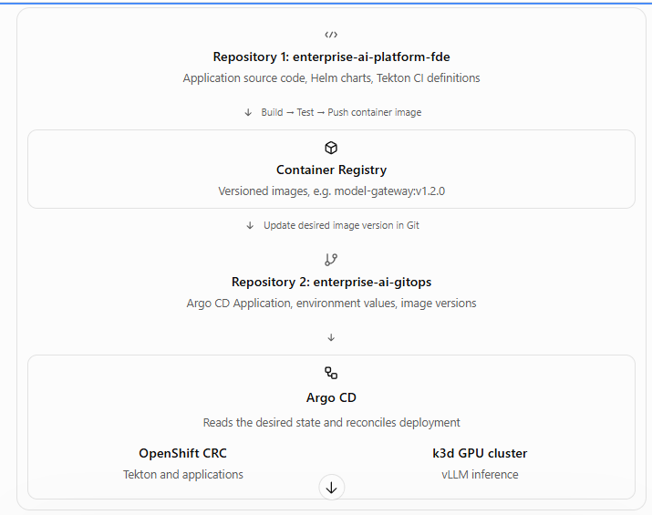

# ai-platform-engineering

enterprise-ai-platform-fde/
├── applications/
│   ├── vllm/
│   ├── model-gateway/
│   ├── rag-service/
│   └── graph-db/
├── infrastructure/
│   ├── gpu/
│   ├── k3d/
│   └── openshift/
├── helm/
│   ├── vllm/
│   └── model-gateway/
├── pipelines/
│   └── tekton/
│       ├── tasks/
│       ├── pipelines/
│       └── triggers/
├── security/
├── observability/
├── airgap/
├── benchmarks/
└── docs/

I recommend two repositories for a production-like separation of duties:
1. enterprise-ai-platform-fde

Application source code, CI pipelines and reusable deployment packages
enterprise-ai-platform-fde/
├── applications/
│   ├── vllm/
│   ├── model-gateway/
│   ├── rag-service/
│   └── graph-db/
├── infrastructure/
│   ├── gpu/
│   ├── k3d/
│   └── openshift/
├── helm/
│   ├── vllm/
│   └── model-gateway/
├── pipelines/
│   └── tekton/
│       ├── tasks/
│       ├── pipelines/
│       └── triggers/
├── security/
├── observability/
├── airgap/
├── benchmarks/
└── docs/

2. enterprise-ai-gitops

Desired cluster state, environment configurations and Argo CD Applications
enterprise-ai-gitops/
├── argocd/
│   ├── bootstrap/
│   ├── applications/
│   └── projects/
├── environments/
│   ├── dev/
│   │   ├── vllm/
│   │   └── gateway/
│   ├── staging/
│   └── production/
├── clusters/
│   ├── k3d/
│   └── openshift/
└── policies/

End-to-end deployment example
When you change the model gateway's Node.js code, Tekton will build and test it, scan its dependencies and container image, and push the image to your registry using an immutable digest.
Tekton will then commit that digest to enterprise-ai-gitops/environments/dev/gateway/. Argo CD will detect the commit, render the manifests, and reconcile the deployment.
For vLLM, the CI workflow will primarily validate Helm charts, runtime configuration and model metadata. We can initially deploy a pinned upstream vLLM image rather than rebuild its large CUDA image on your laptop.
Implementation order
1. Deploy and validate vLLM with Qwen on fde-gpu-v2.
2. Create the Helm chart for vLLM.
3. Install/configure Tekton Pipelines and Triggers.
4. Build the GitHub webhook → Tekton → private registry CI workflow.
5. Configure Argo CD to deploy from enterprise-ai-gitops.
6. Add security gates, promotion, rollback and disconnected deployment support.
For your FDE portfolio, we'll also document Tekton service-account permissions, registry credentials, GitHub webhook authentication, Argo CD RBAC, and rollback procedures.
One architectural decision: We'll use Tekton for all application CI and Argo CD as the sole application deployment controller. This gives us a clean foundation for both Kubernetes and OpenShift.
Our next step is to deploy vLLM with Qwen, then create its Helm chart and connect it to this Tekton–Argo CD workflow.
